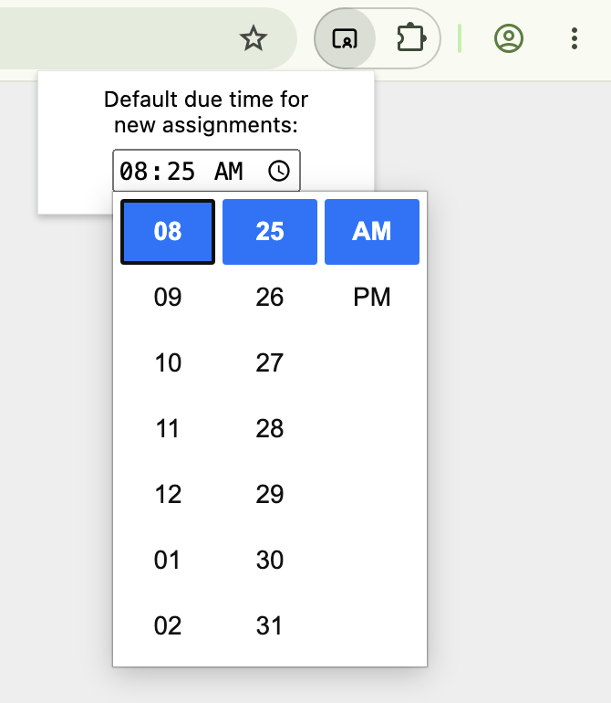

# Teacher Companion for Schoology

A browser extension to help teachers get the most out of Schoology.

> [!TIP]
> As of this writing, the extension is minimal:
>
> - The only supported browser is Google Chrome.
> - The only functionality is to automatically set the Due Time of new assignments. You can set whatever Due Time you like in the extension's options; it defaults to 8:25 a.m.
>
> If you want support for more browsers or features, let us know by [creating a new issue](https://github.com/jeffs/schext/issues/new).

## Installing

First, put the extension on your computer:

1. Download the [zip file](https://github.com/jeffs/schext/releases/download/v0.1.0/schoology-companion.zip).
2. Unzip the file into a new folder.
   - On Windows, right click the file and choose **Extract All**.
   - On macOS, right click the file and choose **Open With** → **Archive Utility**.
   - On Linux, `unzip -d schoology-companion schoology-companion.zip`.
3. Move the `schoology-companion` folder to its permanent home.
   - Your `Documents` folder is a reasonable place to put it.

Then, load the extension in Chrome:

1. Copy the following URL into a new browser window:

   ```
   chrome://extensions
   ```

2. In the top right corner of that page, switch Developer Mode on.  

   

3. Near the top left corner, click **Load Unpacked**.

   

4. Reload any open Schoology tabs.

To try the extension out, create a new assignment, then verify that the Due Time is 8:25 a.m. You can override the default time for new assignments by clicking this extension in your Chrome toolbar:



## Building from source

1. Install [just](https://just.systems/man/en/).
2. `just build`

Or, run the commands in the [justfile](justfile) manually.

Build output is written to the `extension` folder of your working copy. Install it in Chrome using the instructions above.

## License

Copyright (c) 2026 Jeffrey Schwab and Yi Han. All rights reserved. See [LICENSE](LICENSE).

The icon is "chalkboard-teacher" from [Tabler Icons](https://tabler.io/icons), available under the [MIT License](extension/icons/LICENSE).
